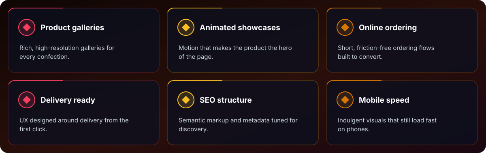
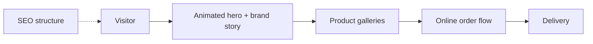

  
  
  
  

  <a href="#-overview"><b>Overview</b></a> &nbsp;•&nbsp;
  <a href="#-features"><b>Features</b></a> &nbsp;•&nbsp;
  <a href="#-tech-stack"><b>Tech</b></a> &nbsp;•&nbsp;
  <a href="#%EF%B8%8F-architecture"><b>Architecture</b></a> &nbsp;•&nbsp;
  <a href="#-source-code"><b>Source</b></a>

## ✨ Overview

**RubyChocoBliss** is a premium chocolate and confectionery brand experience built for conversions and delight. The site features rich product galleries, animated showcases, online ordering flows and delivery-ready UX.

Focus areas included SEO structure, mobile performance, and a brand-forward visual system that feels indulgent without sacrificing speed.

  
   🖥️ Live at <a href="https://rubychocobliss.com"><b>rubychocobliss.com</b></a>

## 🚀 Features

  

| Feature | What it does |
|:--|:--|
| **Product galleries** | Rich, high-resolution galleries for every confection. |
| **Animated showcases** | Motion that makes the product the hero of the page. |
| **Online ordering** | Short, friction-free ordering flows built to convert. |
| **Delivery ready** | UX designed around delivery from the first click. |
| **SEO structure** | Semantic markup and metadata tuned for discovery. |
| **Mobile speed** | Indulgent visuals that still load fast on phones. |

## 🧰 Tech Stack

## 🏗️ Architecture

## 🔒 Source Code

> [!NOTE]
> This is a **showcase repository**. The production source code of **RubyChocoBliss** is private and is not published here.
> Want a walkthrough, a similar build for your business, or licensing? **[Get in touch →](https://ajendra.info/contact)**

## 👤 Author

**Ajendra** — Full Stack Developer · Security Researcher · AI Engineer · Startup Advisor

⭐ If you like this project, star the repo — and check out my other work on <a href="https://ajendra.info/projects">ajendra.info/projects</a>.

